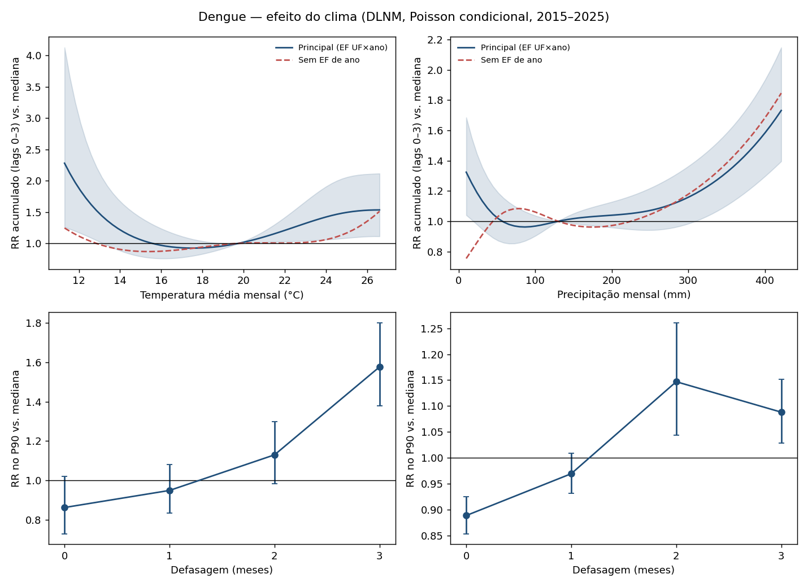
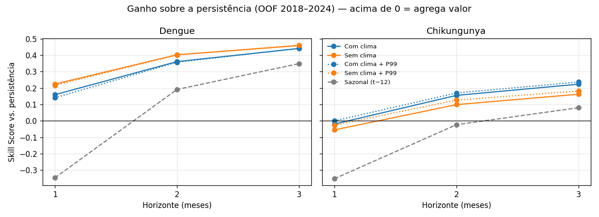
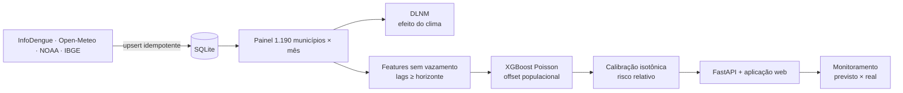

<div align="center">

# 🦟 Clima × Arboviroses

### O calor aumenta a dengue no Sul do Brasil. Mas isso ajuda a prever o próximo surto?

Dados públicos de **1.190 municípios** (PR, SC, RS), **2015–2026**, um protocolo pré-registrado
e uma aplicação web + API que entrega **alerta de risco** e casos previstos por município, de 1 a 3 meses
à frente, sempre com a margem de erro e o desempenho real medido em 2026.


</div>

---

## Em 30 segundos

| Pergunta | Resposta | Evidência |
|---|---|---|
| **O clima afeta o risco?** | **Sim.** Um mês quente (P90, ~24,5 °C) eleva o risco de dengue em **46%** nos 3 meses seguintes | DLNM, IC 95% [1,07–1,99] |
| **O clima ajuda a prever?** | **Pouco.** Melhora a previsão de dengue em ~1% e a de chikungunya em 0% | Experimento controlado, IC por bootstrap |
| **O que ajuda de verdade?** | O histórico de casos e a **imunidade acumulada** da população (−1% a −3,5% de erro) | Mesmo experimento |
| **O alerta funciona?** | **Supera o alerta oficial do InfoDengue** em todas as combinações (AUC 0,76–0,82 contra 0,52–0,68) | Validação 2018–2024 |
| **E no futuro de verdade?** | No teste único de 2026 (meses nunca vistos), ainda supera o InfoDengue (AUC 0,62–0,80 contra 0,53–0,60), mas **perde para "repetir o último mês"** na dengue e superestimou o ano de baixa em 1,5× a 3,5× | Teste prospectivo jan–ago/2026 |
| **Onde ele perde?** | Depois de um ano epidêmico, espera outra temporada grande: errou do mesmo jeito em 2025 e 2026. Nenhum modelo acerta o **tamanho** dos surtos | Dois testes únicos fora da amostra |

> **Tese:** o clima tem efeito mensurável sobre as arboviroses, mas acrescenta pouco à previsão de curto
> prazo além do histórico de casos. A previsão útil é de **risco relativo**, não de magnitude.

---

## O efeito do clima

<p align="center"></p>

Modelo de defasagem distribuída não linear (**DLNM**) por Poisson condicional, com efeitos fixos para a
sazonalidade de cada cidade e para os choques de cada ano em cada estado. Esse controle é o que impede de
confundir "um ano quente" com "um ano de surto" por outros motivos (sorotipo novo, imunidade).

| | Temperatura (P90 vs. mediana) | Precipitação (P90 vs. mediana) |
|---|---|---|
| Dengue | **1,46** [1,07–1,99] | 1,08 [0,94–1,23] |
| Chikungunya | **1,60** [1,04–2,48] | **1,68** [1,36–2,08] |

O efeito da temperatura na dengue cresce com a defasagem e chega ao máximo em ~3 meses, o tempo do ciclo
do mosquito somado à incubação e à notificação.

## O que aprendemos sobre previsão (incluindo o que deu errado)

<p align="center"></p>

- **Primeira versão:** 26 variáveis de clima + índice El Niño **pioravam** a dengue em até 8%. O El Niño é um
  único valor por mês para as 1.190 cidades e virava um "identificador do ano": o modelo decorava surtos
  passados.
- **Teste único em 2025:** a validação prometia ganho, mas o ano real desmentiu. Depois do recorde de 2024,
  o modelo previu outra temporada grande, e 2025 caiu 68% na região inteira.
- **Versão atual:** só 2 variáveis de clima escolhidas antes de ver os dados, imunidade acumulada como
  feature e foco em risco relativo. O ganho do clima ficou pequeno mas real; o do El Niño era ilusão.

## A aplicação

Aplicação web (FastAPI + Plotly) servida pelo mesmo processo da API, com o modelo de produção **v5.1**
(treinado com todos os meses consolidados, 2015-01 a 2026-09):

| Aba | Pergunta | O que responde |
|---|---|---|
| **Previsão por mês** | "Quantos casos em dezembro em Curitiba?" | Até 3 meses à frente: casos com intervalo de 90%, risco relativo, a persistência ao lado e como o modelo se saiu naquele horizonte em 2026. Além disso: a faixa histórica do mês e a data em que a previsão passa a existir |
| **Ranking de risco** | "Onde o risco está mais alto no mês que vem?" | Cidades ordenadas pela probabilidade de ficar acima do próprio padrão, com filtro por UF e população |
| **Próximos 5 anos** | "O que esperar nos próximos anos?" | **Cenário, não previsão:** faixa P10–P90 de cada mês e o efeito de +1/+2 °C pela curva do DLNM (só na parte quente e monotônica da curva) |
| **Quão confiável é** | "Posso confiar?" | AUC, erro, cobertura do intervalo e total previsto ÷ real no teste de 2026, contra persistência e InfoDengue, e o desempenho ao vivo das previsões registradas |

Por que não há previsão para 5 anos: o modelo depende dos casos dos últimos meses; encadear previsões
multiplicaria o erro (a 3 meses ele já superestimou 2026 em 3,5×). Mostrar isso como previsão seria decorar.

## O que a API entrega

```http
GET  /api/previsao?codigo=4106902&doenca=dengue&ano=2026&mes=12   # previsão, faixa ou valor real
GET  /api/ranking?doenca=dengue&h=1&pop_min=10000                 # ranking de risco
GET  /api/cenario?codigo=sul&doenca=dengue&delta_temp=1           # cenário de 5 anos
GET  /api/confiabilidade?doenca=dengue                            # desempenho por horizonte
POST /api/predict
{"codigo_ibge": "4106902", "doenca": "dengue", "meses_a_frente": 2}
```

| Campo | O que é |
|---|---|
| `probabilidade_risco_alto` | Probabilidade calibrada de a incidência passar do P75 histórico **da própria cidade** |
| `nivel_risco` | baixo · médio · alto · crítico |
| `alerta_infodengue_ultimo` | Alerta oficial (1–4) do último mês, para comparação |
| `casos_previstos`, `intervalo_confianca` | Magnitude, sempre com intervalo de 90% |
| `confiabilidade`, `avisos`, `nota` | Quando não confiar: pouco histórico, clima ausente, meses não consolidados |

Cobertura: Região Sul (fora dela → 404). Zika recebe uma explicação em vez de previsão (dados insuficientes).

## Engenharia de dados

| Etapa | Como foi feito |
|---|---|
| **Ingestão** | 4 APIs públicas (InfoDengue, Open-Meteo, NOAA, IBGE) para 1.190 municípios; semanas e dias agregados em meses |
| **Carga** | Incremental e **idempotente** no SQLite: upsert por município × ano × mês, índice único, retomada após falha ou limite de requisições |
| **Histórico imutável** | Meses já usados em análises nunca são sobrescritos; o ano corrente só entra com meses fechados e consolidados |
| **Qualidade** | Checagem de duplicatas, faixas físicas, cobertura e colunas que vazariam o alvo; 2015–2025 conferido contra a fonte (totais idênticos) |
| **Features** | Lags, médias móveis, incidência acumulada e clima defasado, todos calculados só com informação até t − h |
| **Monitoramento** | Toda previsão mensal é registrada **antes** de o mês acontecer e comparada com o real quando os dados consolidam; só a primeira emissão conta |
| **Empacotamento** | Docker com dependências fixas; modelos e snapshot do banco publicados como Release e conferidos por SHA-256 na inicialização |
| **Testes** | 74 testes com dados sintéticos: idempotência da carga, ausência de vazamento, travas de holdout, API, cenários, artefatos |

## Como a IA foi usada, e onde ela foi barrada

O projeto foi desenvolvido com apoio de um agente de IA (Claude Code) para código, revisão e análise.
O que tornou isso confiável foram as regras em volta dele:

- **Pré-registro:** hipóteses, métricas e regra de decisão foram commitadas ([`docs/PROTOCOLO_V5.md`](docs/PROTOCOLO_V5.md))
  **antes** de baixar os dados do teste. Os desvios ficam registrados com data.
- **Holdouts de uso único:** 2025 e 2026 só podem ser testados uma vez; o código grava uma trava.
- **Caça a vazamento:** testes automáticos garantem que nenhuma variável usa informação do futuro. Três
  vazamentos reais foram pegos dessa forma, incluindo o alerta oficial do próprio mês entrando como variável.
- **Comparação honesta:** todo resultado é comparado com "repetir o último mês" e com o alerta oficial.

## Arquitetura



## Rodando

**Com Docker** (baixa os modelos e o banco da Release na primeira execução):

```bash
docker build -t prodigia .
docker run -p 8000:8000 prodigia          # http://localhost:8000  ·  API em /docs
```

**Com Python** (pipeline completo):

```bash
python -m venv .venv && .venv/Scripts/pip install -r requirements.txt

python main.py atualizar-dados          # baixa/atualiza os dados públicos
python main.py dlnm                     # efeito do clima
python main.py experimento-v5           # clima × imunidade acumulada
python main.py modelo-risco --producao  # modelos de produção v5.1 (todos os meses consolidados)
python main.py atualizar-mensal         # rotina mensal: dados novos + monitoramento + previsões
python main.py serve                    # aplicação + API em http://localhost:8000
python main.py empacotar                # zip de modelos + banco para a Release
python -m pytest -q                     # 74 testes, só com dados sintéticos
```

## Estrutura

```
src/processamento/       ingestão das APIs públicas
src/analise_efeito/      DLNM
src/ml_pipeline/         features, experimentos, alerta de risco, testes únicos
src/prediction_service/  preditor, cenários, monitoramento, rotina mensal, artefatos
app/                     FastAPI + aplicação web
deploy/hf_space/         Dockerfile e cartão do Hugging Face Space
docs/                    protocolo, arquitetura, resultados versionados
tests/                   pytest
```

## Próximos passos

- [x] Teste prospectivo **único** em jan–ago/2026 (resultado em [`docs/resultados_v5/`](docs/resultados_v5/teste_prospectivo_2026.md))
- [x] Combinação modelo + persistência (ajuda a 1 mês; não passou na regra pré-registrada)
- [x] Aplicação web, monitoramento ao vivo e empacotamento Docker
- [ ] Corrigir o viés pós-epidemia (v6, com novo pré-registro e teste em 2027)
- [ ] Correção de atraso de notificação (nowcasting) nos meses recentes
- [ ] Artigo científico com os resultados

## Limitações

- Os casos são notificações: há subnotificação e atraso.
- O clima é da reanálise ERA5 no centro de cada município, não de estações locais.
- Só ~10 anos de dinâmica entre anos: sorotipo e imunidade dominam e não são observados diretamente.
- O efeito da temperatura ainda cresce no lag 3: a janela de 0–3 meses pode ser curta.

---

<div align="center">

**Rui Gabriel Oliveira** · engenharia de dados, modelagem e API
Pesquisa de mestrado de Fernando R. D. J. de Oliveira (UNOESC) ·
Melhor trabalho da Região Sul no IV Symposium One Health / Saúde Única (2026)

[LinkedIn](https://www.linkedin.com/in/rui-gabriel-oliveira/) · [GitHub](https://github.com/ruigabriel1)

</div>
