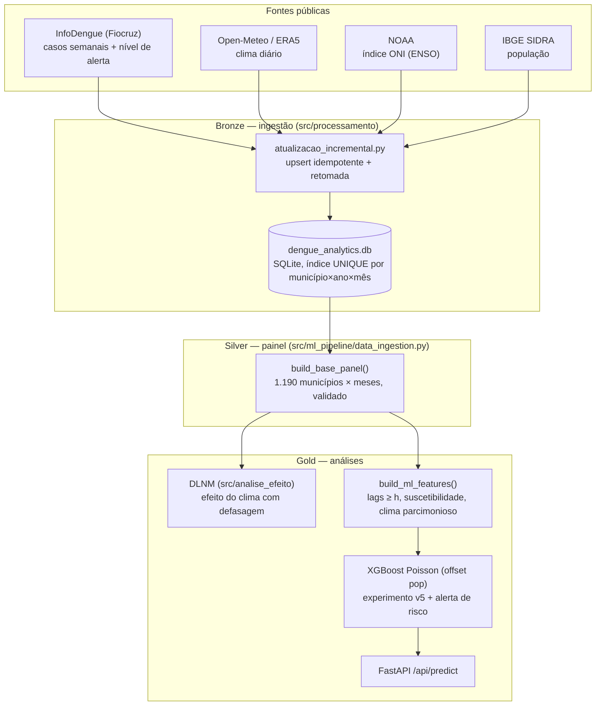

# Arquitetura de Dados — APIs públicas → SQLite → Painel → Efeito e Previsão

## 1. Bronze — ingestão

- `src/processamento/ingestor_api_sul.py`: funções de coleta (InfoDengue agrega semanas em meses, inclusive
  o pior `nivel` de alerta do mês; Open-Meteo agrega dias em médias/somas mensais; NOAA converte o ONI
  trimestral em mensal).
- `src/processamento/atualizacao_incremental.py` (`python main.py atualizar-dados`):
  - **upsert** por (município, ano, mês) com índice UNIQUE — rodar de novo não duplica;
  - **histórico imutável**: meses < 2026 já existentes só recebem as colunas `NIVEL_*`; casos e clima usados
    nos experimentos publicados não são sobrescritos;
  - só meses **fechados**; coluna `INGERIDO_EM` registra a data da ingestão (usada para definir os meses
    "consolidados" do holdout 2026);
  - progresso por cidade em `ingestao_progresso` — uma rodada interrompida retoma de onde parou.
- População: `src/processamento/ingestor_ibge_populacao.py` (SIDRA), interpolada nos anos sem estimativa.

## 2. Silver — painel

`build_base_panel()` junta saúde, clima, ENSO e população, remove as colunas `CASOS_EST_*`
(estimativas de nowcasting, idênticas ao alvo = vazamento), limita umidade a 100%, padroniza nomes e
códigos (6 dígitos). `validate_panel()` checa duplicatas, cobertura, faixas físicas e vazamento.

## 3. Gold — duas análises separadas

- **Efeito (inferência):** `src/analise_efeito/dlnm.py` — Poisson condicional com efeitos fixos
  cidade×mês-calendário e UF×ano, cross-basis de temperatura e chuva (lags 0–3 meses).
- **Previsão (produto):** `build_ml_features(panel, doenca, horizonte)` gera apenas features com informação
  até t−h; `get_feature_columns(..., clima, suscetibilidade)` seleciona os grupos do protocolo v5.
  O alerta de risco é calibrado e servido em `/api/predict`.

---

## 4. Evolução histórica

- **v1 (CSVs):** SINAN e INMET em arquivos largos, 48 CSVs por faixa de latitude. Abandonada por falhas de
  medição do INMET (-9999) e manutenção manual.
- **v2–v3 (APIs + SQLite):** robô de ingestão e banco local; modelos por faixa de latitude e projeções SSP.
- **v4 (experimento final):** XGBoost Poisson, expanding window, teste único em 2025
  (`docs/resultados_experimento/`). Mostrou que o clima com 26 variáveis + ENSO piorava a dengue e que o
  modelo de contagem perdia para a persistência em 2025.
- **v5 (atual):** poda das projeções SSP e do legado, ingestão idempotente, DLNM para o efeito do clima,
  clima parcimonioso, suscetibilidade e produto de alerta de risco com holdout prospectivo 2026
  (`docs/PROTOCOLO_V5.md`).
