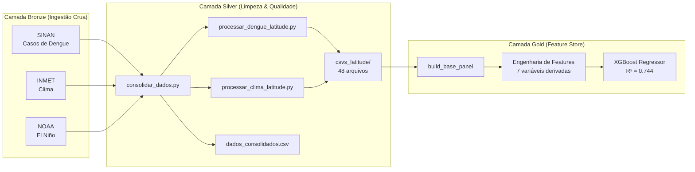

# Arquitetura de Dados — Pipeline Medallion

Este documento descreve a arquitetura de dados do projeto, seguindo o padrão **Medallion Architecture** (Bronze → Silver → Gold) adaptado para execução local com visão de migração para nuvem.

## Visão Geral do Pipeline

---

## 1. Camada Bronze — Ingestão Crua

**Princípio:** Os dados são armazenados exatamente como vieram da fonte oficial, sem nenhuma modificação. Esta camada serve como histórico imutável e auditável.

| Fonte | Arquivo | Schema |
|-------|---------|--------|
| SINAN | `data/raw/dengue_MENSAL.csv` | Formato wide: linhas = municípios, colunas = meses (Jan/2015 a Dez/2024) |
| INMET | `data/raw/Temp_media_MENSAL.csv`, `Temp_minima_MENSAL.csv`, `Temp_maxima_MENSAL.csv`, `precipitacao_mensal_rev.csv` | Mesmo formato wide |
| NOAA | `data/raw/elnino_lanina_2015-2024.csv` | Formato tabular: ano, mês, índice ONI |

**Armazenamento Local:** `data/raw/`
**Equivalente Cloud:** Data Lake (Google Cloud Storage bucket ou AWS S3), com particionamento por fonte e data de ingestão. Os arquivos seriam ingeridos via Cloud Functions ou Apache Airflow como DAG agendada.

---

## 2. Camada Silver — Limpeza & Qualidade

**Princípio:** Aplicar regras de qualidade e transformar os dados wide (uma coluna por mês) em formato long (uma linha por município/mês), garantindo a integridade para consumo analítico.

### Regras de Qualidade Implementadas

| Regra | Implementação | Justificativa |
|-------|---------------|---------------|
| Filtro de Outliers Climáticos | `temp.where((temp > -50) & (temp < 10000))` | Estações INMET offline exportam valores como -9999 ou -99.9 |
| Preenchimento de Lacunas Epidemiológicas | `dengue.fillna(0)` | Meses sem notificação no SINAN representam zero casos, não dados faltantes |
| Arredondamento | `.round(2)` | Padronizar precisão para 2 casas decimais |
| Parser ENSO resiliente | Matching por prefixo de 3 caracteres (`jan`, `fev`, `mar`) | O CSV do NOAA usa nomes de meses em português com possíveis problemas de encoding |

### Saídas da Camada Silver

| Artefato | Local | Descrição |
|----------|-------|-----------|
| Dados Consolidados | `data/processed/dados_consolidados.csv` | Série temporal regional agregada (121 registros mensais) |
| CSVs por Latitude | `output/csvs_latitude/` (48 arquivos) | Dados por município, separados em 8 faixas de latitude × 4 variáveis (dengue, temp_media, temp_minima, precipitação) |

**Armazenamento Local:** `data/processed/` e `output/csvs_latitude/`
**Equivalente Cloud:** Tabelas em Data Warehouse (Google BigQuery ou AWS Redshift), ou arquivos Parquet particionados no Data Lake. A limpeza seria orquestrada por Apache Airflow / Cloud Composer com validação via Great Expectations.

---

## 3. Camada Gold — Feature Store para ML

**Princípio:** Construir o painel final de features derivadas, prontas para consumo direto pelo algoritmo de Machine Learning, sem necessidade de transformações adicionais.

### Construção do Painel

A função `build_base_panel()` em `src/processamento/motor_lote_modelagem_v2_por_latitude.py` é responsável por:
1. Carregar os 48 CSVs da Camada Silver
2. Cruzar dengue × clima × ENSO por município/mês
3. Retornar um DataFrame de **142.800 linhas** (1.190 municípios × 120 meses)

### Schema Final (7 Features de Entrada + 1 Target)

| Feature | Nome Técnico | Tipo | Descrição |
|---------|-------------|------|-----------|
| Temperatura Média (lag 3 meses) | `temp_lag3` | float | Temperatura média do município, defasada em 3 meses |
| Precipitação (lag 3 meses) | `prec_lag3` | float | Chuva mensal em mm, defasada em 3 meses |
| Índice El Niño (lag 3 meses) | `enso_lag3` | float | Índice ONI do NOAA, defasado em 3 meses |
| Latitude | `latitude` | float | Coordenada geográfica do município |
| Pico Histórico | `max_historico` | float | Máximo de casos em um único mês na história da cidade (proxy de população) |
| Casos Mês Anterior | `casos_lag1` | float | Dengue no mês t-1 (velocidade de contágio) |
| Casos Mesmo Mês Ano Anterior | `casos_lag12` | float | Dengue no mês t-12 (memória imunológica) |
| **Target** | `dengue_cases` | float | Casos de dengue no mês corrente |

**Armazenamento Local:** Gerado em memória (DataFrame Pandas) durante a execução dos notebooks
**Equivalente Cloud:** Feature Store (Vertex AI Feature Store, SageMaker Feature Store, ou Feast). As features seriam materializadas em tabelas versionadas para rastreabilidade de experimentos.

---

## 4. Orquestração (Atual vs Evolução)

| Aspecto | Implementação Atual | Evolução Planejada |
|---------|--------------------|--------------------|
| **Orquestração** | `main.py` com CLI (Click) | Apache Airflow / Cloud Composer com DAGs agendadas |
| **Armazenamento Bronze** | `data/raw/` (filesystem local) | GCS Bucket / S3 com versionamento |
| **Armazenamento Silver** | `data/processed/` + `output/csvs_latitude/` | BigQuery / Redshift + Parquet no Data Lake |
| **Feature Store** | DataFrame em memória | Vertex AI Feature Store / Feast |
| **Modelo ML** | XGBoost treinado no notebook | MLflow para versionamento + Vertex AI para serving |
| **Monitoramento** | Verificação manual | Great Expectations + alertas automáticos |
