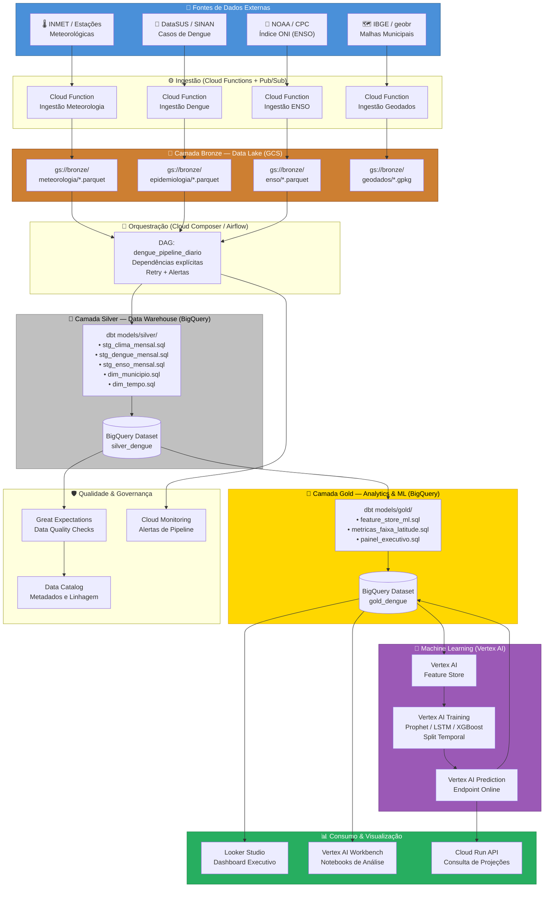
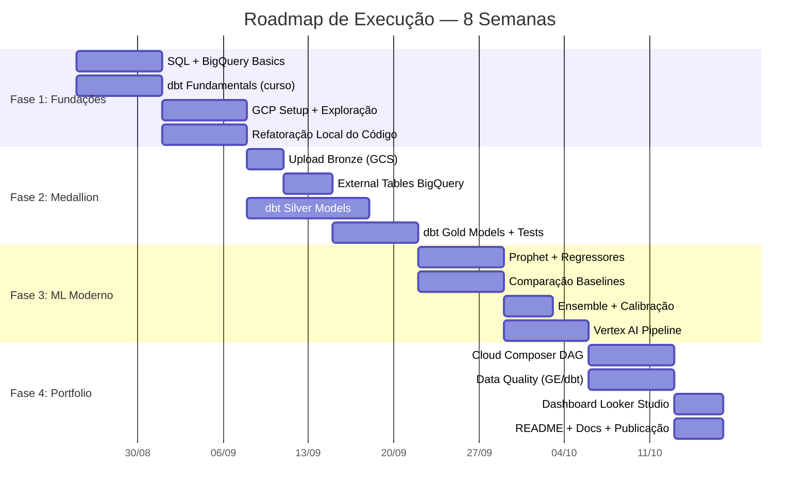

# 🏗️ Mentoria: Projeto Clima × Dengue — Engenharia de Dados Sênior

> Análise completa do seu projeto de correlação clima–dengue na Região Sul do Brasil, com reestruturação para nível de portfólio sênior.

---

## A. Análise Crítica do Processo Atual

### ✅ O que você fez de certo

1. **Separação Raw → Processed já existe**
   Você já tem `data/raw/` e `data/processed/`, o que demonstra consciência de imutabilidade dos dados brutos. Isso é o embrião da Medallion Architecture.

2. **Centralização de configuração em [`config.py`](file:///c:/Users/ruiga/OneDrive/Documents/Projeto_Clima_X_Dengue/src/config.py)**
   Parâmetros como `LAG_MESES = 3`, `ANO_INICIO_HISTORICO`, `ANO_FIM_PROJECAO` estão centralizados — boa prática de engenharia.

3. **Feature engineering com lag temporal**
   Criar variáveis defasadas de 2 e 3 meses em [`consolidar_dados.py`](file:///c:/Users/ruiga/OneDrive/Documents/Projeto_Clima_X_Dengue/src/consolidar_dados.py) é excelente e mostra entendimento do domínio epidemiológico (o mosquito precisa de semanas para proliferar após condições favoráveis).

4. **Estratificação por faixa de latitude (8 faixas)**
   Dividir os 1.190 municípios do Sul em 8 faixas de latitude para capturar gradientes climáticos é uma decisão analítica sofisticada e bem fundamentada.

5. **Validação de integridade**
   Ter um módulo [`src/validacao/`](file:///c:/Users/ruiga/OneDrive/Documents/Projeto_Clima_X_Dengue/src/validacao/) com verificação de tipagem, nulos, limites físicos e detecção de outliers (IQR) é acima da média para projetos de pesquisa.

6. **Cache de geodados**
   Cachear GeoPackages localmente em `data/geodados/` em vez de depender de APIs externas em runtime é uma decisão madura de engenharia.

7. **Cenário contrafactual**
   Ter um motor "sem incremento" (`motor_lote_modelagem_v2_sem_incremento.py`) como baseline de controle mostra rigor metodológico.

8. **Volume e completude do output**
   +150 artefatos entre CSVs, mapas, PDFs e DOCX — o projeto entrega valor tangível e documentado.

---

### 🚨 O que você deve corrigir urgentemente

#### 1. Caminhos Absolutos Hardcoded — **Severidade: CRÍTICA**

```python
# motor_lote_modelagem_v2_por_latitude.py, linha 48
ROOT_DATA_DIR = Path(r"c:\Users\ruiga\OneDrive\Documents\Projeto_Clima_X_Dengue")
```

> [!CAUTION]
> O projeto **não roda em nenhuma outra máquina**. Qualquer recrutador que clonar o repo e rodar `python main.py` vai receber um `FileNotFoundError`. Isso destrói a portabilidade do portfólio.

**Correção**: Todos os módulos devem usar `BASE_DIR` de `src.config` (que já usa `Path(__file__).resolve().parents[1]`).

#### 2. Duplicação da Lógica Wide→Long — **Severidade: ALTA**

A mesma lógica de parsing de cabeçalhos complexos (skiprows, melt, rename) está **copiada em 4 arquivos diferentes**:
- `consolidar_dados.py`
- `processar_dengue_latitude_mapas.py`
- `processar_clima_por_latitude.py`
- `motor_lote_modelagem_v2_por_latitude.py`

> [!WARNING]
> Se você descobrir um bug no parsing, precisa corrigir em 4 lugares. Eventualmente um fica dessincronizado, gerando dados inconsistentes silenciosamente.

**Correção**: Extrair um parser canônico `parse_wide_monthly()` em [`src/data/loaders.py`](file:///c:/Users/ruiga/OneDrive/Documents/Projeto_Clima_X_Dengue/src/data/loaders.py).

#### 3. Pipeline sem Orquestração de Dependências — **Severidade: ALTA**

O [`main.py`](file:///c:/Users/ruiga/OneDrive/Documents/Projeto_Clima_X_Dengue/main.py) expõe 3 comandos (`process-data`, `run-model`, `generate-reports`), mas:
- `processar_dengue_latitude_mapas.py` **precisa rodar antes** de `processar_clima_por_latitude.py`
- O `process-data` **não inclui** esses dois passos obrigatórios
- O `run-model` depende de outputs que podem não existir

> [!WARNING]
> Não há DAG de dependências. O pipeline falha silenciosamente se executado fora de ordem.

#### 4. Nomenclatura Inconsistente de Colunas — **Severidade: MÉDIA**

| Arquivo | Coluna de ano | Coluna de casos |
|---|---|---|
| `consolidar_dados.py` | `year` | `dengue_cases` |
| `processar_dengue_latitude_mapas.py` | `ano` | `CASOS_DENGUE` |
| `motor_v2` | `ANO` | `incidencia_dengue` |

Isso dificulta joins entre outputs e torna o debug um pesadelo.

#### 5. Sem Testes Unitários — **Severidade: MÉDIA**

O `validar_todas_tarefas.py` verifica presença de artefatos, mas não há **testes unitários** (pytest) para as funções de transformação. Qualquer refatoração é arriscada sem rede de segurança.

#### 6. Arquivo Temporário na Raiz — **Severidade: BAIXA**

[`tmp_debug_report.py`](file:///c:/Users/ruiga/OneDrive/Documents/Projeto_Clima_X_Dengue/tmp_debug_report.py) solto na raiz — transmite impressão de projeto inacabado. Mover para `scripts/debug/` ou remover.

#### 7. README Desatualizado — **Severidade: BAIXA**

[`README.md`](file:///c:/Users/ruiga/OneDrive/Documents/Projeto_Clima_X_Dengue/README.md) linha 124 referencia `python src/pipeline-Jubileu_Plus.py`, que **não existe** no repositório.

---

## B. Arquitetura de Dados — Medallion Architecture

### Desenho das Camadas

| Camada | Propósito | Ferramenta | Formato |
|---|---|---|---|
| **🥉 Bronze** | Ingestão bruta, dados imutáveis como chegaram da fonte | GCS Bucket `gs://dengue-sul-bronze/` | CSV/Parquet, particionado por fonte |
| **🥈 Silver** | Dados limpos, padronizados, deduplicados, tipados | BigQuery Dataset `silver_dengue` | Tabelas particionadas por `ano_mes` |
| **🥇 Gold** | Métricas agregadas, features prontas para ML e dashboards | BigQuery Dataset `gold_dengue` | Views materializadas e tabelas otimizadas |

### Detalhamento por Camada

#### 🥉 Bronze — Ingestão Bruta

```
gs://dengue-sul-bronze/
├── meteorologia/
│   ├── temperatura_media/   ← CSVs originais wide (imutáveis)
│   ├── temperatura_minima/
│   ├── temperatura_maxima/
│   └── precipitacao/
├── epidemiologia/
│   └── dengue_mensal/       ← CSVs originais do DataSUS
├── enso/
│   └── oni_noaa/            ← Índice ONI mensal
└── geodados/
    └── municipios_sul/      ← GeoPackages de contornos
```

**Regras da Bronze:**
- Dados **nunca** são alterados após ingestão
- Cada arquivo recebe metadados de ingestão: `_ingested_at`, `_source_file`, `_checksum`
- Schema-on-read (sem imposição de schema na chegada)

#### 🥈 Silver — Dados Limpos e Padronizados

| Tabela | Descrição |
|---|---|
| `silver_dengue.fato_clima_mensal` | Clima mensal por município (long format), colunas padronizadas |
| `silver_dengue.fato_dengue_mensal` | Incidência de dengue por município/mês |
| `silver_dengue.dim_municipio` | Dimensão com código IBGE, nome, UF, latitude, longitude, faixa de latitude |
| `silver_dengue.dim_tempo` | Calendário mensal com safras epidemiológicas |
| `silver_dengue.fato_enso_mensal` | ONI mensal com classificação (El Niño / Neutro / La Niña) |

**Transformações Silver (dbt):**
- Wide → Long (pivot)
- Padronização de nomes de colunas (`snake_case`, português)
- Tratamento de nulos e outliers (regras de `validar_integridade_dados.py`)
- Tipagem forte (DATE, FLOAT64, INT64, STRING)
- Deduplicação por chave natural `(cod_ibge, ano_mes)`

#### 🥇 Gold — Features e Métricas

| Tabela/View | Descrição |
|---|---|
| `gold_dengue.feature_store_ml` | Feature store para ML: clima com lag 1/2/3, ONI, sazonalidade, log(dengue+1) |
| `gold_dengue.metricas_faixa_latitude` | Médias mensais agregadas por faixa de latitude |
| `gold_dengue.painel_executivo` | View materializada para dashboard Looker Studio |
| `gold_dengue.projecoes_ssp` | Resultados das projeções 2025–2040 sob cenários SSP |
| `gold_dengue.predicoes_ml` | Predições do modelo de ML com intervalos de confiança |

---

### Diagrama Mermaid — Arquitetura Completa



### Mapeamento: Seu Código Atual → Arquitetura Nova

| Seu código atual | Camada | Substituto na nova arquitetura |
|---|---|---|
| Scripts de download manual + CSVs em `data/raw/` | Bronze | Cloud Functions + GCS Bucket |
| `consolidar_dados.py` + `processar_*.py` | Silver | dbt models em `models/silver/` |
| `motor_lote_modelagem_v2*.py` (feature engineering) | Gold | dbt models em `models/gold/feature_store_ml.sql` |
| `motor_lote_modelagem_v2*.py` (modelo ML) | ML | Vertex AI Training Pipeline |
| `src/mapas/*.py` + `src/relatorios/*.py` | Consumo | Looker Studio + Notebooks |
| `src/validacao/*.py` | Qualidade | Great Expectations + dbt tests |
| `main.py` (CLI sequencial) | Orquestração | Cloud Composer DAG com dependências |

---

## C. Estratégia de Machine Learning e Projeção

### C.1 Análise do Seu Modelo Atual

Você está usando `HistGradientBoostingRegressor` do scikit-learn com:
- Split temporal: treino ≤2021, validação 2022, teste 2023–2024
- Rollout recursivo mensal 2025–2040
- Intercepto local $\alpha_{local}$ por município (mediana dos resíduos)

> [!NOTE]
> **O que está bom**: O split temporal é correto (nunca usar dados futuros para treinar). O intercepto local captura heterogeneidade municipal. O lag de 3 meses é epidemiologicamente fundamentado.

> [!WARNING]
> **Problemas identificados**:
> - `HistGradientBoostingRegressor` **não é projetado para séries temporais** — ignora autocorrelação temporal e sazonalidade
> - O rollout recursivo de 15 anos (2025→2040) **acumula erro exponencialmente** — após ~2 anos as projeções perdem significância
> - Não há intervalo de confiança nas predições (apenas ponto)
> - Não há comparação com baselines (média histórica, SARIMA ingênuo)

### C.2 Algoritmos Recomendados para Este Problema

Para previsão de séries temporais cruzando clima e epidemiologia, a literatura e a prática indicam uma abordagem **ensemble hierárquica**:

#### Tier 1 — Modelo Principal: **Prophet + Regressores Exógenos**

| Aspecto | Justificativa |
|---|---|
| Sazonalidade | Prophet captura sazonalidade anual automaticamente (pico de dengue no verão) |
| Tendência | Modelagem não-linear com changepoints |
| Regressores | Aceita variáveis exógenas: `temperatura_lag3`, `precipitacao_lag3`, `oni_index` |
| Incerteza | Gera **intervalos de confiança** nativamente (quantis) |
| Interpretabilidade | Decomposição aditiva: tendência + sazonalidade + regressores |

```python
from prophet import Prophet

model = Prophet(
    yearly_seasonality=True,
    weekly_seasonality=False,
    daily_seasonality=False,
    changepoint_prior_scale=0.05,
    seasonality_mode='multiplicative'  # Dengue tem amplitude sazonal proporcional
)

# Regressores climáticos com lag
model.add_regressor('temp_media_lag3')
model.add_regressor('precipitacao_lag3')
model.add_regressor('oni_index')
model.add_regressor('faixa_latitude', mode='multiplicative')
```

#### Tier 2 — Modelo Complementar: **LightGBM com TimeSeriesSplit**

Para capturar interações não-lineares que o Prophet não modela:

```python
from sklearn.model_selection import TimeSeriesSplit
import lightgbm as lgb

features = [
    'temp_media_lag1', 'temp_media_lag2', 'temp_media_lag3',
    'precip_lag1', 'precip_lag2', 'precip_lag3',
    'oni_index', 'oni_lag1', 'oni_lag2',
    'mes_sin', 'mes_cos',  # Sazonalidade cíclica
    'faixa_latitude',
    'dengue_lag1', 'dengue_lag2', 'dengue_lag3',  # Autoregressivo
    'dengue_lag12',  # Sazonalidade anual
]

tscv = TimeSeriesSplit(n_splits=5, gap=3)  # gap=3 para respeitar o lag
```

#### Tier 3 — Validação e Ensemble

| Métrica | Finalidade |
|---|---|
| MAE (Mean Absolute Error) | Erro médio em escala original |
| MAPE (Mean Absolute % Error) | Erro relativo — cuidado com zeros |
| SMAPE | Alternativa ao MAPE que lida melhor com zeros |
| CRPS (Continuous Ranked Probability Score) | Avalia a qualidade dos intervalos de confiança |

**Ensemble final**: Média ponderada Prophet (60%) + LightGBM (40%), com pesos calibrados por performance no conjunto de validação.

#### Tier Exploratório — Deep Learning (se quiser se diferenciar)

- **N-BEATS** (Neural Basis Expansion Analysis): Estado da arte em previsão univariada, da Uber
- **TFT** (Temporal Fusion Transformer): Modelo multimodal que aceita séries + variáveis estáticas (latitude) + variáveis conhecidas no futuro (cenários SSP)
- **Implementação**: via biblioteca `pytorch-forecasting` ou `neuralforecast`

### C.3 Fontes de Dados ENSO para Ingestão Contínua

| Fonte | URL | Frequência | Formato |
|---|---|---|---|
| **NOAA ONI** (oficial) | `https://origin.cpc.ncep.noaa.gov/products/analysis_monitoring/ensostuff/detrend.nino34.ascii.txt` | Mensal | TXT tabulado |
| **NOAA CPC SST** | `https://www.cpc.ncep.noaa.gov/data/indices/oni.ascii.txt` | Mensal | ASCII |
| **IRI/Columbia** | `https://iri.columbia.edu/our-expertise/climate/forecasts/enso/current/` | Mensal | JSON/HTML |
| **BOM Australia** | `http://www.bom.gov.au/climate/enso/` | Mensal | CSV |

**Estratégia de ingestão**: Cloud Function agendada (Cloud Scheduler → Pub/Sub → Cloud Function) rodando no 5° dia útil de cada mês para capturar a atualização do ONI.

### C.4 Integração do ML na Camada Gold

```mermaid
flowchart LR
    subgraph GOLD["🥇 Gold Layer"]
        FS["feature_store_ml<br/>(BigQuery Table)"]
    end

    subgraph VERTEX["🤖 Vertex AI"]
        TRAIN["Training Pipeline<br/>Prophet + LightGBM"]
        REGISTRY["Model Registry<br/>Versionado"]
        ENDPOINT["Prediction Endpoint<br/>Online Serving"]
    end

    subgraph RESULTADOS["📊 Resultados"]
        PRED_TABLE["gold_dengue.predicoes_ml<br/>(BigQuery)"]
        DASHBOARD["Looker Studio<br/>Painel de Projeções"]
    end

    FS -->|"Features limpas<br/>com lag"| TRAIN
    TRAIN -->|"Modelo treinado"| REGISTRY
    REGISTRY -->|"Deploy"| ENDPOINT
    ENDPOINT -->|"Batch predict"| PRED_TABLE
    PRED_TABLE --> DASHBOARD

    style GOLD fill:#FFD700,stroke:#DAA520
    style VERTEX fill:#9B59B6,stroke:#6C3483,color:#fff
    style RESULTADOS fill:#27AE60,stroke:#1E8449,color:#fff
```



**Fluxo mensal automatizado:**
1. Airflow DAG detecta novos dados na Bronze
2. dbt roda modelos Silver → Gold (inclui feature engineering com lags)
3. Vertex AI Training Pipeline retreina o ensemble com dados atualizados
4. Batch prediction gera projeções atualizadas em `gold_dengue.predicoes_ml`
5. Looker Studio atualiza automaticamente via BigQuery connection

---

## D. Plano de Estudo e Execução — Roadmap de 8 Semanas

### Fase 1: Fundações (Semanas 1–2)

| Dia | Tarefa | Recurso |
|---|---|---|
| Sem 1 | **SQL para Analytics** — Dominar CTEs, Window Functions, QUALIFY, PIVOT/UNPIVOT no BigQuery | [BigQuery SQL Reference](https://cloud.google.com/bigquery/docs/reference/standard-sql/query-syntax) |
| Sem 1 | **dbt Fundamentals** — Curso oficial gratuito (6h) | [dbt Learn](https://courses.getdbt.com/courses/fundamentals) |
| Sem 2 | **GCP Data Engineering** — Criar conta, explorar GCS e BigQuery Console | [Google Cloud Skills Boost](https://www.cloudskillsboost.google/) |
| Sem 2 | **Refatoração local**: Eliminar paths hardcoded, extrair parser canônico, padronizar colunas | Seu repositório atual |

**Entregável**: Repositório local limpo + queries SQL equivalentes às suas transformações Python.

### Fase 2: Migração para Medallion (Semanas 3–4)

| Dia | Tarefa | Recurso |
|---|---|---|
| Sem 3 | Upload dos CSVs raw para GCS Bucket Bronze | `gsutil cp` ou Console GCP |
| Sem 3 | Criar External Tables no BigQuery apontando para GCS | BigQuery Console |
| Sem 3-4 | **Escrever modelos dbt Silver**: `stg_clima_mensal.sql`, `stg_dengue_mensal.sql`, `dim_municipio.sql` | dbt + BigQuery |
| Sem 4 | **Escrever modelos dbt Gold**: `feature_store_ml.sql`, `metricas_faixa_latitude.sql` | dbt + BigQuery |
| Sem 4 | Adicionar **dbt tests** (unique, not_null, accepted_values, relationships) | dbt docs |

**Entregável**: Pipeline dbt completo rodando `dbt run && dbt test` com sucesso.

### Fase 3: Machine Learning Moderno (Semanas 5–6)

| Dia | Tarefa | Recurso |
|---|---|---|
| Sem 5 | **Prophet** — Tutorial oficial + implementar modelo com regressores exógenos | [Prophet Docs](https://facebook.github.io/prophet/) |
| Sem 5 | **Comparação de baselines** — SARIMA, Prophet, LightGBM com TimeSeriesSplit | scikit-learn + statsmodels |
| Sem 6 | **Ensemble** — Combinar Prophet + LightGBM com pesos calibrados | Notebook de experimentação |
| Sem 6 | **Vertex AI** — Registrar modelo no Model Registry, criar Training Pipeline | [Vertex AI Docs](https://cloud.google.com/vertex-ai/docs) |

**Entregável**: Modelo ensemble com métricas de validação publicadas e intervalos de confiança.

### Fase 4: Orquestração e Portfolio (Semanas 7–8)

| Dia | Tarefa | Recurso |
|---|---|---|
| Sem 7 | **Cloud Composer/Airflow** — Criar DAG com dependências Bronze→Silver→Gold→ML | [Composer Docs](https://cloud.google.com/composer/docs) |
| Sem 7 | **Data Quality** — Implementar Great Expectations ou dbt expectations package | [Great Expectations](https://greatexpectations.io/) |
| Sem 8 | **Dashboard** — Criar painel no Looker Studio conectado à Gold Layer | Looker Studio |
| Sem 8 | **Documentação** — README profissional, diagramas Mermaid, badges, GIF demo | Seu repositório |

**Entregável**: Pipeline end-to-end orquestrado + dashboard + repositório de portfólio publicado.

---

### Resumo Visual do Roadmap



---

## Próximos Passos Imediatos

> [!IMPORTANT]
> Os 3 problemas críticos locais foram corrigidos como "quick wins":
>
> 1. ✅ ~~Eliminar **todos** os caminhos absolutos hardcoded~~ — **FEITO** (5 arquivos corrigidos)
> 2. ⬜ Extrair parser canônico `parse_wide_monthly()` em `src/data/loaders.py` — pendente
> 3. ⬜ Padronizar nomenclatura de colunas (criar dicionário de dados) — pendente

---

## E. Como Executar o Pipeline (Passo a Passo)

### Pré-requisitos

```bash
# 1. Clone o repositório
git clone https://github.com/SEU_USUARIO/Projeto_Clima_X_Dengue.git
cd Projeto_Clima_X_Dengue

# 2. Crie o ambiente virtual
python -m venv .venv

# 3. Ative o ambiente
# Windows:
.venv\Scripts\activate
# Linux/Mac:
source .venv/bin/activate

# 4. Instale dependências
pip install -r requirements.txt

# 5. Coloque os dados brutos em data/raw/ (ver data/README.md)
```

### Execução Completa (ordem obrigatória)

```bash
# ╔════════════════════════════════════════════════════╗
# ║  PASSO 1 — Consolidar dados brutos                ║
# ║  Lê CSVs de data/raw/, limpa, padroniza e gera    ║
# ║  data/processed/dados_consolidados.csv             ║
# ╚════════════════════════════════════════════════════╝
python main.py process-data

# ╔════════════════════════════════════════════════════╗
# ║  PASSO 2 — Processar dengue por faixas de latitude ║
# ║  Transforma wide→long, gera 8 CSVs por latitude    ║
# ║  em output/csvs_latitude/                          ║
# ╚════════════════════════════════════════════════════╝
python src/processamento/processar_dengue_latitude_mapas.py

# ╔════════════════════════════════════════════════════╗
# ║  PASSO 3 — Processar clima por faixas de latitude  ║
# ║  Depende do Passo 2! Divide temperaturas e chuva   ║
# ║  por latitude em output/csvs_latitude/             ║
# ╚════════════════════════════════════════════════════╝
python src/processamento/processar_clima_por_latitude.py

# ╔════════════════════════════════════════════════════╗
# ║  PASSO 4 — Motor principal: Projeções + ML         ║
# ║  Treina modelo, projeta 2025–2040 sob cenários SSP ║
# ║  Gera PDFs, CSVs e métricas em output/projecoes/   ║
# ╚════════════════════════════════════════════════════╝
python main.py run-model

# ╔════════════════════════════════════════════════════╗
# ║  PASSO 5 (opcional) — Cenário contrafactual        ║
# ║  Projeções sem incremento climático (baseline)     ║
# ╚════════════════════════════════════════════════════╝
python src/processamento/motor_lote_modelagem_v2_sem_incremento.py
```

### Arquivos para Validação

Após cada passo, abra estes arquivos para confirmar que tudo funcionou:

| Passo | Arquivo para validar | O que verificar |
|---|---|---|
| 1 | `data/processed/dados_consolidados.csv` | 121 linhas, 20 colunas, período 2015-01 a 2025-12 |
| 2 | `output/csvs_latitude/dengue_faixa_latitude_1.csv` | Dados de dengue para a faixa 22°S–23°S |
| 2 | `output/mapas_latitude/mapa_municipios_latitude_2024.png` | Mapa coroplético do último ano |
| 3 | `output/csvs_latitude/temp_media_faixa_latitude_1.csv` | Temperaturas divididas por latitude |
| 3 | `output/medias_latitude/todas_faixas_medias_mensais.csv` | Médias consolidadas de todas as faixas |
| 4 | `output/projecoes_regionais/projecao_regiao_sul_consolidado.csv` | Projeções SSP 2025–2040 |
| 4 | `output/projecoes_regionais/relatorio_executivo_completo.pdf` | Relatório executivo com gráficos |
| 4 | `output/projecoes_regionais/ml_completo/metricas_ml_completo.json` | Métricas do modelo ML (MAE, RMSE, R²) |
| 5 | `output/projecoes_sem_incremento/projecao_regiao_sul_sem_incremento_2025_2040.csv` | Baseline sem incremento climático |

