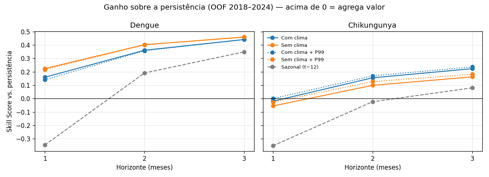

# Fase 2 — Análise do experimento (OOF 2018–2024, holdout 2025 intocado)

Métricas calculadas no conjunto agregado de todos os folds de validação (expanding window). Surto = mês acima do P90 da própria cidade (treino); risco alto = acima da mediana da cidade (treino). Skill = ganho de MAE sobre a persistência no mesmo horizonte (casos[t−h]).

Critérios: MAE < persistência · R² > 0,40 (dengue) · MAE-surto < 50% do pico médio · Skill > 0 · AUC > 0,75.

## Dengue

| h | Modelo | MAE | R² | MAE-surto (% pico) | Skill | AUC | Passa todos |
|---|---|---|---|---|---|---|---|
| 1 | persistencia | 26.60 | 0.570 | 122.2 (68%) | 0.000 | 0.852 | ❌ |
| 1 | sazonal | 35.83 | 0.266 | 156.6 (88%) | -0.347 | 0.748 | ❌ |
| 1 | xgb_clima_p99 | 22.86 | 0.412 | 108.1 (61%) | 0.141 | 0.908 | ❌ |
| 1 | xgb_clima_semcorte | 22.36 | 0.430 | 105.3 (59%) | 0.159 | 0.909 | ❌ |
| 1 | xgb_semclima_p99 | 20.84 | 0.517 | 97.1 (54%) | 0.216 | 0.909 | ❌ |
| 1 | xgb_semclima_semcorte | 20.64 | 0.517 | 95.9 (54%) | 0.224 | 0.909 | ❌ |
| 2 | persistencia | 44.30 | -0.092 | 184.9 (105%) | 0.000 | 0.807 | ❌ |
| 2 | sazonal | 35.83 | 0.266 | 154.0 (88%) | 0.191 | 0.750 | ❌ |
| 2 | xgb_clima_p99 | 28.48 | 0.284 | 132.5 (75%) | 0.357 | 0.889 | ❌ |
| 2 | xgb_clima_semcorte | 28.31 | 0.302 | 131.3 (75%) | 0.361 | 0.889 | ❌ |
| 2 | xgb_semclima_p99 | 26.52 | 0.418 | 119.8 (68%) | 0.401 | 0.893 | ❌ |
| 2 | xgb_semclima_semcorte | 26.46 | 0.444 | 118.9 (68%) | 0.403 | 0.893 | ❌ |
| 3 | persistencia | 55.02 | -0.533 | 204.0 (117%) | 0.000 | 0.769 | ❌ |
| 3 | sazonal | 35.83 | 0.266 | 153.3 (88%) | 0.349 | 0.750 | ❌ |
| 3 | xgb_clima_p99 | 30.70 | 0.217 | 142.9 (82%) | 0.442 | 0.876 | ❌ |
| 3 | xgb_clima_semcorte | 30.76 | 0.214 | 142.7 (82%) | 0.441 | 0.876 | ❌ |
| 3 | xgb_semclima_p99 | 29.63 | 0.332 | 131.9 (75%) | 0.461 | 0.879 | ❌ |
| 3 | xgb_semclima_semcorte | 29.78 | 0.329 | 131.7 (75%) | 0.459 | 0.880 | ❌ |

### Efeito do clima (ΔMAE = com clima − sem clima; negativo = clima ajuda)

| h | corte P99 | ΔMAE | IC 95% (bootstrap por cidade) | Δ% | Conclusão |
|---|---|---|---|---|---|
| 1 | sim | +2.014 | [+1.255, +2.985] | +9.7% | clima piora |
| 1 | não | +1.724 | [+1.070, +2.598] | +8.4% | clima piora |
| 2 | sim | +1.952 | [+1.205, +2.907] | +7.4% | clima piora |
| 2 | não | +1.851 | [+1.068, +2.884] | +7.0% | clima piora |
| 3 | sim | +1.067 | [+0.413, +1.986] | +3.6% | clima piora |
| 3 | não | +0.976 | [+0.291, +1.868] | +3.3% | clima piora |

### SHAP do modelo com clima (treino 2015–2024, amostra 2022–2024)

| h | nº features clima | % do |SHAP| total vindo do clima | melhor feature de clima (rank) | top 5 |
|---|---|---|---|---|
| 1 | 26 | 12.7% | tmin_lag1 (#9) | dengue_lag1, dengue_rolling_3, log_pop, month_cos, dengue_incid_lag1 |
| 2 | 26 | 26.2% | receptivo_lag2 (#6) | dengue_lag2, log_pop, month_sin, dengue_incid_lag2, dengue_rolling_12 |
| 3 | 26 | 32.0% | tmax_lag3 (#6) | log_pop, dengue_lag3, dengue_lag12, month_sin, dengue_rolling_12 |

### Configuração sugerida pela regra pré-registrada

- **xgb_semclima_semcorte** (clima=não, corte P99=não)
- Ganho médio de Skill com clima: {'p99': -0.0464, 'semcorte': -0.0414} (limiar 0.01)
- Corte P99: redução de MAE -0.15%, perda de R² 0.0078

## Chikungunya

| h | Modelo | MAE | R² | MAE-surto (% pico) | Skill | AUC | Passa todos |
|---|---|---|---|---|---|---|---|
| 1 | persistencia | 0.20 | 0.471 | 3.3 (72%) | 0.000 | 0.690 | ❌ |
| 1 | sazonal | 0.26 | -0.530 | 4.7 (104%) | -0.353 | 0.618 | ❌ |
| 1 | xgb_clima_p99 | 0.20 | 0.163 | 3.4 (75%) | -0.000 | 0.893 | ❌ |
| 1 | xgb_clima_semcorte | 0.20 | 0.170 | 3.4 (75%) | -0.020 | 0.894 | ❌ |
| 1 | xgb_semclima_p99 | 0.20 | 0.189 | 3.3 (73%) | -0.027 | 0.893 | ❌ |
| 1 | xgb_semclima_semcorte | 0.21 | 0.195 | 3.3 (72%) | -0.056 | 0.895 | ❌ |
| 2 | persistencia | 0.26 | -0.224 | 4.4 (97%) | 0.000 | 0.652 | ❌ |
| 2 | sazonal | 0.26 | -0.530 | 4.7 (104%) | -0.024 | 0.618 | ❌ |
| 2 | xgb_clima_p99 | 0.21 | 0.091 | 3.8 (83%) | 0.170 | 0.879 | ❌ |
| 2 | xgb_clima_semcorte | 0.22 | 0.094 | 3.8 (83%) | 0.155 | 0.880 | ❌ |
| 2 | xgb_semclima_p99 | 0.23 | 0.104 | 3.6 (80%) | 0.127 | 0.880 | ❌ |
| 2 | xgb_semclima_semcorte | 0.23 | 0.107 | 3.6 (79%) | 0.099 | 0.881 | ❌ |
| 3 | persistencia | 0.29 | -0.578 | 4.9 (106%) | 0.000 | 0.633 | ❌ |
| 3 | sazonal | 0.26 | -0.530 | 4.8 (104%) | 0.080 | 0.618 | ❌ |
| 3 | xgb_clima_p99 | 0.22 | 0.065 | 4.0 (86%) | 0.237 | 0.871 | ❌ |
| 3 | xgb_clima_semcorte | 0.22 | 0.065 | 4.0 (86%) | 0.223 | 0.871 | ❌ |
| 3 | xgb_semclima_p99 | 0.24 | 0.079 | 3.8 (83%) | 0.181 | 0.870 | ❌ |
| 3 | xgb_semclima_semcorte | 0.24 | 0.082 | 3.8 (82%) | 0.162 | 0.872 | ❌ |

### Efeito do clima (ΔMAE = com clima − sem clima; negativo = clima ajuda)

| h | corte P99 | ΔMAE | IC 95% (bootstrap por cidade) | Δ% | Conclusão |
|---|---|---|---|---|---|
| 1 | sim | -0.005 | [-0.007, -0.003] | -2.6% | clima ajuda |
| 1 | não | -0.007 | [-0.010, -0.005] | -3.4% | clima ajuda |
| 2 | sim | -0.011 | [-0.014, -0.007] | -4.9% | clima ajuda |
| 2 | não | -0.015 | [-0.017, -0.011] | -6.2% | clima ajuda |
| 3 | sim | -0.016 | [-0.019, -0.013] | -6.7% | clima ajuda |
| 3 | não | -0.018 | [-0.021, -0.014] | -7.3% | clima ajuda |

### SHAP do modelo com clima (treino 2015–2024, amostra 2022–2024)

| h | nº features clima | % do |SHAP| total vindo do clima | melhor feature de clima (rank) | top 5 |
|---|---|---|---|---|
| 1 | 26 | 15.4% | receptivo_lag1 (#7) | chik_rolling_12, log_pop, chik_lag1, chik_rolling_3, dengue_lag1 |
| 2 | 26 | 21.0% | receptivo_lag2 (#5) | log_pop, chik_rolling_12, chik_lag2, month_sin, receptivo_lag2 |
| 3 | 26 | 21.2% | receptivo_lag3 (#6) | log_pop, chik_rolling_12, month_sin, chik_lag3, dengue_rolling_3 |

### Configuração sugerida pela regra pré-registrada

- **xgb_clima_p99** (clima=sim, corte P99=sim)
- Ganho médio de Skill com clima: {'p99': 0.0415, 'semcorte': 0.0511} (limiar 0.01)
- Corte P99: redução de MAE 1.78%, perda de R² 0.0028

## Diagnóstico exploratório: qual grupo de clima move o erro? (NÃO usado na decisão)

MAE no OOF 2018–2024, sem corte. Δ% relativo ao modelo sem clima (negativo = melhora).

| Doença | h | Variante | nº features | MAE | Δ% vs sem clima |
|---|---|---|---|---|---|
| dengue | 1 | sem_clima | 16 | 20.640 | +0.0% |
| dengue | 1 | clima_completo | 42 | 22.364 | +8.4% |
| dengue | 1 | clima_sem_enso | 35 | 21.590 | +4.6% |
| dengue | 1 | so_enso | 23 | 22.272 | +7.9% |
| dengue | 1 | so_temp_prec_local | 25 | 21.191 | +2.7% |
| dengue | 3 | sem_clima | 16 | 29.779 | +0.0% |
| dengue | 3 | clima_completo | 42 | 30.755 | +3.3% |
| dengue | 3 | clima_sem_enso | 35 | 30.183 | +1.4% |
| dengue | 3 | so_enso | 23 | 30.577 | +2.7% |
| dengue | 3 | so_temp_prec_local | 25 | 30.318 | +1.8% |
| chikungunya | 1 | sem_clima | 16 | 0.206 | +0.0% |
| chikungunya | 1 | clima_completo | 42 | 0.199 | -3.4% |
| chikungunya | 1 | clima_sem_enso | 35 | 0.204 | -1.2% |
| chikungunya | 1 | so_enso | 23 | 0.198 | -3.8% |
| chikungunya | 1 | so_temp_prec_local | 25 | 0.205 | -0.8% |
| chikungunya | 3 | sem_clima | 16 | 0.241 | +0.0% |
| chikungunya | 3 | clima_completo | 42 | 0.223 | -7.3% |
| chikungunya | 3 | clima_sem_enso | 35 | 0.225 | -6.7% |
| chikungunya | 3 | so_enso | 23 | 0.223 | -7.5% |
| chikungunya | 3 | so_temp_prec_local | 25 | 0.237 | -1.7% |

## Regra de decisão (pré-registrada)

1. Clima entra só se o Skill médio (3 horizontes) com clima superar o sem clima em > 0.01.
2. Corte P99 entra só se reduzir o MAE médio em > 1% sem perder > 0.01 de R².

> A configuração acima é uma **sugestão**. Revise e confirme antes de rodar `python main.py teste-final --confirmar` — o holdout 2025 só pode ser usado uma vez.