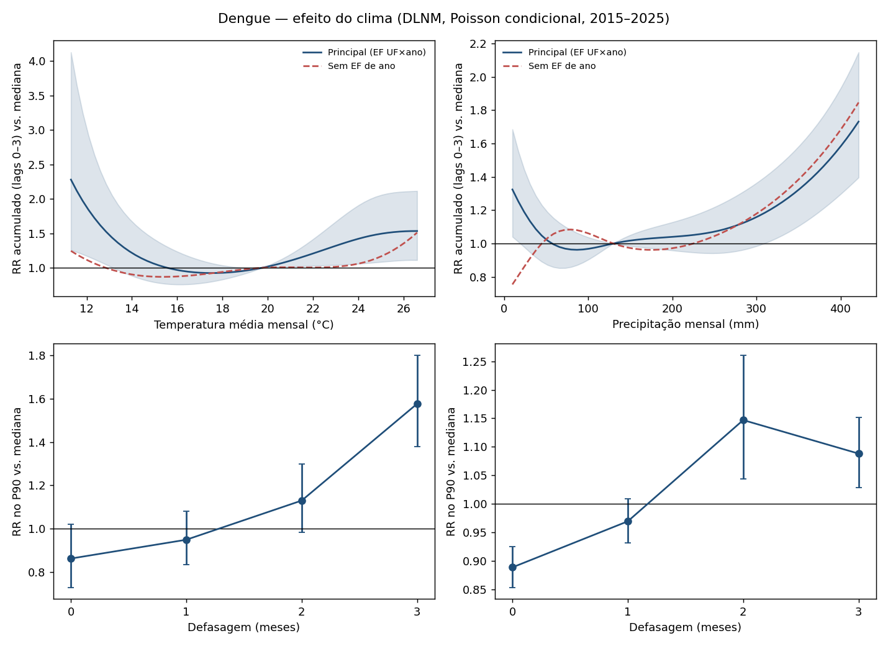
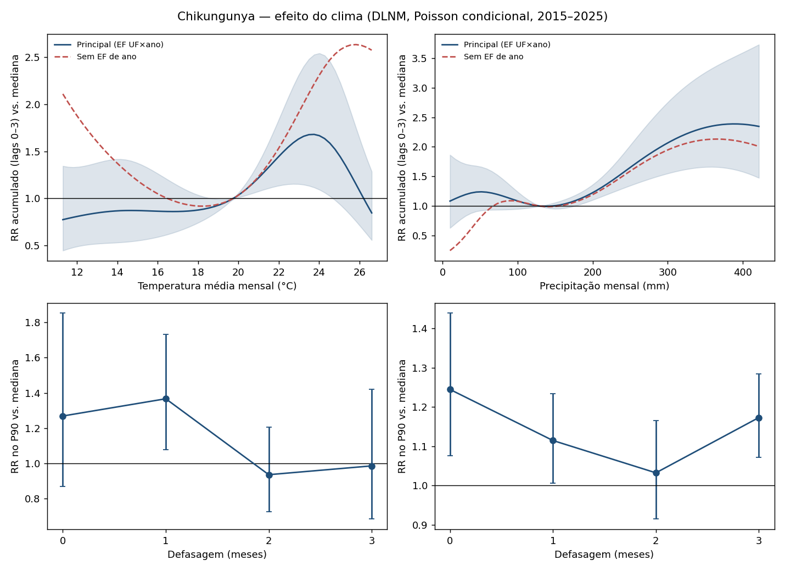

# DLNM — efeito do clima sobre a incidência (2015–2025)

RR acumulado nos lags 0–3 meses, no P10 e no P90 da variável, em relação à mediana. Principal: EF cidade×mês + UF×ano, termo autorregressivo, offset log(pop), EP agrupado por município.

| Doença | Especificação | Variável | Ponto | Valor | Mediana | RR | IC 95% |
|---|---|---|---|---|---|---|---|
| dengue | principal | temp_media | P10 | 14.2 | 19.75 | 1.176 | [0.860, 1.609] |
| dengue | principal | temp_media | P90 | 24.46 | 19.75 | 1.459 | [1.070, 1.989] |
| dengue | principal | precipitacao | P10 | 44.3 | 129.8 | 1.049 | [0.892, 1.234] |
| dengue | principal | precipitacao | P90 | 253.1 | 129.8 | 1.075 | [0.942, 1.226] |
| dengue | sem_ef_ano | temp_media | P10 | 14.2 | 19.75 | 0.893 | [0.724, 1.102] |
| dengue | sem_ef_ano | temp_media | P90 | 24.46 | 19.75 | 1.099 | [0.843, 1.431] |
| dengue | sem_ef_ano | precipitacao | P10 | 44.3 | 129.8 | 0.998 | [0.873, 1.141] |
| dengue | sem_ef_ano | precipitacao | P90 | 253.1 | 129.8 | 1.051 | [0.923, 1.196] |
| dengue | sem_autorregressivo | temp_media | P10 | 14.2 | 19.75 | 2.147 | [0.809, 5.701] |
| dengue | sem_autorregressivo | temp_media | P90 | 24.46 | 19.75 | 3.600 | [1.405, 9.222] |
| dengue | sem_autorregressivo | precipitacao | P10 | 44.3 | 129.8 | 0.580 | [0.442, 0.761] |
| dengue | sem_autorregressivo | precipitacao | P90 | 253.1 | 129.8 | 0.881 | [0.649, 1.195] |
| chikungunya | principal | temp_media | P10 | 14.2 | 19.75 | 0.870 | [0.534, 1.417] |
| chikungunya | principal | temp_media | P90 | 24.46 | 19.75 | 1.601 | [1.035, 2.475] |
| chikungunya | principal | precipitacao | P10 | 44.3 | 129.8 | 1.236 | [0.909, 1.680] |
| chikungunya | principal | precipitacao | P90 | 253.1 | 129.8 | 1.680 | [1.360, 2.076] |
| chikungunya | sem_ef_ano | temp_media | P10 | 14.2 | 19.75 | 1.332 | [0.794, 2.236] |
| chikungunya | sem_ef_ano | temp_media | P90 | 24.46 | 19.75 | 2.455 | [1.492, 4.038] |
| chikungunya | sem_ef_ano | precipitacao | P10 | 44.3 | 129.8 | 0.716 | [0.546, 0.939] |
| chikungunya | sem_ef_ano | precipitacao | P90 | 253.1 | 129.8 | 1.616 | [1.355, 1.927] |
| chikungunya | sem_autorregressivo | temp_media | P10 | 14.2 | 19.75 | 0.589 | [0.302, 1.151] |
| chikungunya | sem_autorregressivo | temp_media | P90 | 24.46 | 19.75 | 7.412 | [2.329, 23.589] |
| chikungunya | sem_autorregressivo | precipitacao | P10 | 44.3 | 129.8 | 0.834 | [0.479, 1.452] |
| chikungunya | sem_autorregressivo | precipitacao | P90 | 253.1 | 129.8 | 0.836 | [0.385, 1.816] |

