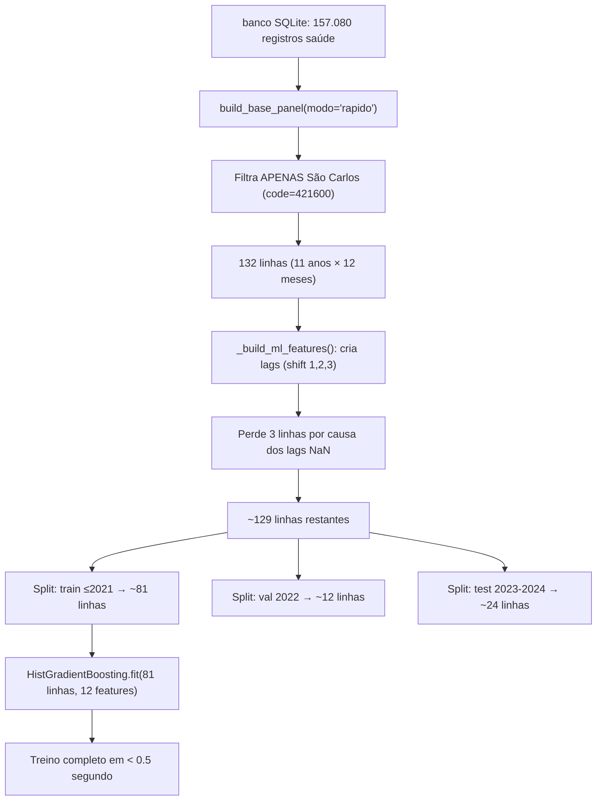

# Plano de Correção — Backend Prodígia + Diagnóstico ML

## Diagnóstico Completo

### 🔴 RESPOSTA À PERGUNTA CRÍTICA: "Por que a CPU não está sendo consumida?"

**Porque o modelo está sendo treinado com apenas ~81 linhas de dados.**

O fluxo atual funciona assim:



> [!CAUTION]
> **81 linhas para treinar um modelo com 12 features é extremamente pouco.** O `HistGradientBoostingRegressor` com `max_iter=500` e `min_samples_leaf=max(10, 81//20)=10` termina em milissegundos. Não há carga computacional real. O treinamento inteiro (incluindo I/O do SQLite, features, projeções, gráficos matplotlib) leva ~4 segundos no total.

### Evidência concreta — Backtest mostra modelo fraco:

| Mês | Casos Reais | Previsão ML |
|-----|-------------|-------------|
| 2022-03 | 22 | 0.72 |
| 2022-04 | **158** | **0.81** |
| 2022-05 | 97 | 0.11 |

O modelo **não consegue aprender padrões de surto** com tão poucos dados. Prevê ~1 caso quando o real é 158.

### Projeções suspeitas — Valores praticamente constantes:

| Cenário | 2026 | 2027 | 2028 | 2029 | 2030 |
|---------|------|------|------|------|------|
| SSP126 | 192 | 192 | 192 | 192 | 192 |
| SSP245 | 192 | 192 | 192 | 189 | 189 |
| SSP585 | 193 | 191 | 202 | 213 | 227 |

Os valores são quase idênticos entre cenários e anos porque:
1. O modelo é fraco (treinado com poucos dados)
2. A projeção recursiva (mês a mês) faz os lags convergirem para um ponto fixo rapidamente
3. As variações climáticas entre cenários são muito sutis (+0.02°C/ano para SSP126 vs +0.08°C/ano para SSP585)

---

## Bugs Identificados no Backend

### Bug 1: Treinamento TRIPLO redundante
Em [ml_runner.py](file:///c:/Users/ruiga/OneDrive/Documents/Projeto_Clima_X_Dengue/app/ml_runner.py), a função `treinar()` treina o modelo **3 vezes**:

1. **Linha 113-119**: Treina `model` (train split ≤2021)
2. **Linha 132**: Chama `run_full_ml()` que treina **outro modelo internamente** (linhas 934-945 do motor) + re-treina com dados completos (linhas 960-969)
3. **Linha 136-141**: Treina `full_model` de novo para feature importance

São 4 modelos treinados no total, sendo que os resultados do primeiro (linha 113) são **descartados** porque as métricas usadas vêm do `run_full_ml()`.

### Bug 2: O `run_full_ml` usa `min_samples_leaf=40` com 81 linhas de treino

No [motor](file:///c:/Users/ruiga/OneDrive/Documents/Projeto_Clima_X_Dengue/src/processamento/motor_lote_modelagem_v2_por_latitude.py#L934-L942):
```python
model = HistGradientBoostingRegressor(
    min_samples_leaf=40,  # ← Hardcoded!
)
```
Com apenas ~81 linhas de treino, `min_samples_leaf=40` significa que cada folha precisa de **metade dos dados**. O modelo mal consegue criar divisões significativas.

### Bug 3: Encoding do `app_v2.js` corrompido
Todo o arquivo JavaScript tem caracteres mojibake (ex: `Prodígia` em vez de `Prodígia`, `Gráfico` em vez de `Gráfico`). Isso aconteceu porque o PowerShell salvou o arquivo com encoding errado.

### Bug 4: IDs de métricas no HTML não existem
O JS tenta preencher `#erro-abs-val`, `#tendencia-val`, `#risco-val` (linha 114-128 do JS), mas esses IDs **não existem no HTML** — foram removidos na limpeza anterior.

### Bug 5: Variáveis mortas no JS
`chartBarras`, `chartFI`, `chartSerieTemporal`, `chartClima`, `chartHeatmap` são declaradas mas nunca mais usadas (os gráficos correspondentes foram removidos do HTML).

---

## Proposta de Correção

### Fase 1: Corrigir o pipeline ML (Backend)

#### [MODIFY] app/ml_runner.py
- **Eliminar treinamento redundante**: Remover o primeiro treino (linhas 113-127) e o re-treino de feature importance (linhas 136-141). Usar apenas `run_full_ml()` que já faz tudo.
- **Extrair métricas e feature importance do `run_full_ml()`**: Modificar `run_full_ml()` para retornar as métricas e importâncias, ou lê-las dos CSVs que ele gera.
- **Ajustar `min_samples_leaf` dinamicamente**: Usar `max(5, len(train_df) // 20)` em vez de hardcoded 40.

#### [MODIFY] src/processamento/motor_lote_modelagem_v2_por_latitude.py  
- Tornar `min_samples_leaf` dinâmico baseado no tamanho do dataset
- Retornar métricas de `run_full_ml()` para que o caller possa usá-las

### Fase 2: Corrigir o Frontend

#### [MODIFY] app/static/app_v2.js
- Corrigir encoding UTF-8 (reescrever strings com caracteres corretos)
- Remover variáveis e funções mortas
- Remover referências a IDs inexistentes (`erro-abs-val`, etc.)

#### [MODIFY] app/templates/index.html
- Atualizar versão do script cache-bust (`?v=9`)

### Fase 3: Melhorar qualidade do modelo (Opcional — discussão necessária)

> [!IMPORTANT]
> **Decisão necessária**: Com apenas 132 registros mensais de São Carlos, o modelo terá qualidade limitada inevitavelmente. Opções:
> 
> **Opção A** — Manter modo "rápido" mas **treinar com TODAS as cidades** e usar o modelo regional para projetar São Carlos. Muito mais dados (~157k registros → ~3000+ linhas de features), CPU vai subir significativamente.
>
> **Opção B** — Manter como está (1 cidade, 132 registros) mas ajustar hiperparâmetros para datasets pequenos e documentar as limitações.
>
> **Opção C** — Usar modo "regional" como padrão, treinando com todas as cidades do Sul e depois filtrando projeções para São Carlos.

---

## Verificação

### Testes automatizados
```bash
python -c "from app.ml_runner import treinar; r=treinar(); print('Keys:', list(r.keys())); print('Projecao nao-vazia:', bool(r['projecao_cenarios'])); print('N registros:', r['n_registros'])"
```

### Verificação manual
1. Abrir http://127.0.0.1:8001
2. Clicar "Treinar Prodígia"
3. Verificar que a barra de progresso avança
4. Verificar que a tabela 2026-2030 preenche com dados
5. Verificar que os gráficos de barras e linha renderizam
6. Verificar que os botões de download CSV/PNG funcionam
7. Verificar que o tema escuro funciona
