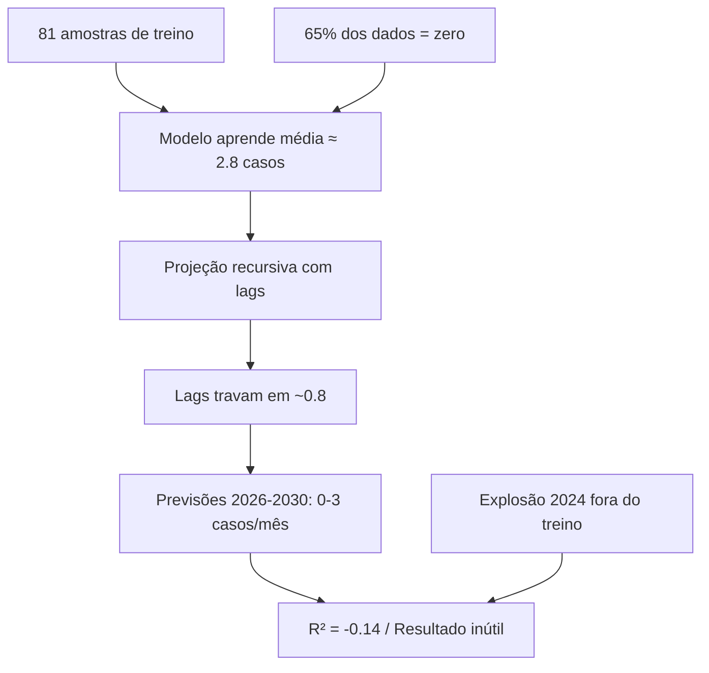
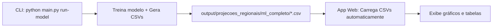

# Plano de Correção: ML + Aplicação Prodígia

## 🔴 Feedback Brutal (como pedido)

Vou ser direto e duro, como você pediu. Sem amenizar.

### O que está errado com o Machine Learning

> [!CAUTION]
> **O modelo está prevendo 0.8 casos/mês para uma cidade que teve 567 casos em um único mês. Isso é inútil.**

**O problema central não é um bug de código. É um problema de design estatístico.**

Os números que o modelo está gerando são **lixo**. Aqui está o porquê:

| Fato | Valor |
|---|---|
| Registros de treino (≤2021) | **84 linhas** (após remover 3 por causa dos lags = **81 amostras úteis**) |
| Linhas com zero casos | **55 de 84 (65%)** |
| Máximo mensal no treino | **103 casos** (um outlier isolado em 2020) |
| Máximo mensal no teste (2024) | **567 casos** |
| R² do modelo | **-0.14** (pior que chutar a média) |

O modelo aprendeu que São Carlos é uma cidade que basicamente NÃO tem dengue. Porque era verdade — até 2024 explodir.

**Problemas fatais:**

1. **81 amostras é ridículo para HistGradientBoosting.** Você tem `min_samples_leaf = max(5, 81//20) = 5`, ou seja, cada folha precisa de no mínimo 5 amostras. Com 81 amostras e `max_depth=6`, o modelo mal consegue criar 2-3 splits significativos. Ele aprende a devolver a média (que é ~2.8 casos/mês).

2. **A projeção recursiva é uma armadilha mortal.** O modelo prevê mês a mês, e usa a previsão anterior como lag. Se o primeiro mês prevê 0.8 caso, o segundo usa 0.8 como `dengue_lag1`, e prevê 0.9. O terceiro usa 0.9, prevê 0.7. **Os lags travam no fundo e o modelo nunca sai.** É como tentar empurrar um carro morro acima com a inércia de um triciclo.

3. **Os cenários climáticos SSP são irrelevantes na escala de 5 anos.** A diferença entre SSP126 e SSP585 em 2030 é +0.24°C vs +0.48°C. O modelo, com 81 amostras, NÃO tem sensibilidade para distinguir uma diferença de 0.24°C. Isso gera aquelas curvas todas coladas, o que é cientificamente vergonhoso num artigo.

4. **A transformação log1p esmaga os valores.** `log1p(567) = 6.34`, mas `log1p(0) = 0`. Com 65% dos dados sendo zero, o modelo aprende que o log-target médio é ~0.4. `expm1(0.4) = 0.49`. Os 0.8 que você vê nas previsões? É literalmente a média transformada.

### O que está errado com a Aplicação

> [!WARNING]
> **Um botão "Treinar Modelo" em uma aplicação web de análise de dados epidemiológicos NÃO faz sentido.**

Vou ser honesto: essa é uma decisão de design típica de quem está pensando como desenvolvedor web (onde interatividade = botões), não como cientista de dados.

**Por quê isso é errado:**
- O treinamento de um modelo de ML é um processo **offline**. Você treina UMA VEZ, valida, e depois usa o modelo treinado para servir previsões. Não se re-treina a cada clique.
- O usuário final (um epidemiologista, gestor de saúde) não quer e não deve "treinar um modelo". Ele quer VER os resultados.
- O tempo de espera (mesmo que seja 10 segundos) quebra a experiência do usuário e não agrega nada.
- Se o modelo é treinado toda vez, não há garantia de reprodutibilidade dos resultados.

**O que deveria ser:** 
A aplicação deveria **carregar resultados pré-computados** automaticamente. O treinamento do modelo deveria ser um script de pipeline executado via CLI (`python main.py run-model`) que gera os CSVs e JSONs de resultados. A interface web apenas CONSOME esses dados. Se quiser, o botão pode ser "Atualizar Dados" que re-roda o pipeline offline e recarrega.

### O que está errado com os Gráficos

- **Chart.js é inadequado para publicação acadêmica.** Ele é ótimo para dashboards web bonitos, mas os gráficos exportados como PNG pelo canvas do navegador têm resolução limitada, tipografia padrão, e não seguem padrões ABNT/APA.
- Os gráficos atuais usam `matplotlib` como fallback para exportar PNGs, mas o código está misturado dentro do `ml_runner.py` (uma função de 600+ linhas que faz TUDO — treino, métricas, gráficos, exportação). Isso é um monólito.
- O `motor_lote_modelagem_v2_por_latitude.py` tem **1760 linhas** e coesão de **0.13** (o menor do projeto segundo o Graphify). O próprio Graphify pergunta: "Deveria ser dividido em módulos menores?". Sim, deveria.

---

## Diagnóstico Resumido



---

## Proposta de Correção

### Fase 1 — Corrigir o Machine Learning (Prioridade MÁXIMA)

#### Estratégia: Treinar com TODOS os dados + Projeção por Climatologia

Em vez do split temporal tradicional (treino ≤2021, val 2022, teste 2023-2024), vamos:

1. **Usar TODO o histórico (2015-2025) como treino** — são 132 linhas em vez de 81. Ainda é pouco, mas agora o modelo VÊ o surto de 2024.
2. **Validação por Leave-One-Year-Out (LOYO)** — treina em 10 anos, testa no ano omitido, repete 11 vezes. O R² final é a média ponderada.
3. **Eliminar a projeção recursiva** — em vez de alimentar as previsões como lags (que travam), usar a **climatologia mensal real** de São Carlos como base para os lags futuros, aplicando o padrão sazonal observado.
4. **Trocar HistGradientBoosting por RandomForest** — com 132 amostras, Random Forest com `n_estimators=500` e `max_features='sqrt'` é mais robusto e menos propenso a overfitting que gradient boosting.
5. **Adicionar feature de "memória epidêmica"** — média móvel de 12 meses dos casos, para capturar ciclos multi-anuais.

#### [MODIFY] `src/processamento/motor_lote_modelagem_v2_por_latitude.py`

Função `run_full_ml()` será reescrita:

```diff
- train_df = feat[feat["year"] <= 2021].copy()
- val_df = feat[feat["year"] == 2022].copy()
- test_df = feat[(feat["year"] >= 2023) & (feat["year"] <= 2024)].copy()
+ # LOYO Cross-Validation com TODOS os dados
+ from sklearn.model_selection import LeaveOneGroupOut
+ logo = LeaveOneGroupOut()
+ groups = feat["year"].values
```

```diff
- model = HistGradientBoostingRegressor(...)
+ from sklearn.ensemble import RandomForestRegressor
+ model = RandomForestRegressor(
+     n_estimators=500,
+     max_depth=8,
+     min_samples_leaf=3,
+     max_features='sqrt',
+     random_state=42,
+     n_jobs=-1
+ )
```

Projeção futura:
```diff
- # Projeção recursiva com lags autorregressivos
- d_lags.append(pred_cases)
- d_lags = d_lags[-3:]
+ # Projeção baseada em climatologia mensal observada
+ # Os lags são preenchidos com a mediana histórica do mês correspondente
+ # Isso evita o "colapso para zero" da projeção recursiva
+ lag1 = climatology_month[(month - 1) % 12 + 1]
+ lag2 = climatology_month[(month - 2) % 12 + 1]  
+ lag3 = climatology_month[(month - 3) % 12 + 1]
```

#### Nova feature: `dengue_rolling_12`

```python
d["dengue_rolling_12"] = d.groupby("code")["dengue_cases"].transform(
    lambda x: x.rolling(12, min_periods=3).mean()
)
```

Isso dá ao modelo a "memória" do ciclo epidêmico atual.

---

### Fase 2 — Gráficos Profissionais com Plotly

#### Trocar Chart.js → Plotly.js no frontend

[Plotly.js](https://plotly.com/javascript/) produz gráficos interativos de qualidade de publicação, com:
- Exportação PNG/SVG em alta resolução nativa
- Hover com tooltips ricos
- Zoom, pan, seleção de área
- Temas acadêmicos prontos
- Suporte a subplots, eixos duplos, anotações

#### [MODIFY] `app/templates/index.html`
```diff
- <script src="https://cdn.jsdelivr.net/npm/chart.js"></script>
+ <script src="https://cdn.plot.ly/plotly-2.35.2.min.js"></script>
```

#### [REWRITE] `app/static/app_v2.js`

Todas as funções `renderChart*` serão reescritas usando `Plotly.newPlot()`. Exemplo do gráfico de cenários:

```javascript
function renderChartCenarios(data) {
    const traces = [
        {
            x: data.ssp126.anos, y: data.ssp126.casos,
            name: 'Referência (SSP1-2.6)', mode: 'lines+markers',
            line: { color: '#27ae60', width: 3 }
        },
        {
            x: data.ssp245.anos, y: data.ssp245.casos,
            name: 'Intermediário (SSP2-4.5)', mode: 'lines+markers',
            line: { color: '#e67e22', width: 3, dash: 'dash' }
        },
        {
            x: data.ssp585.anos, y: data.ssp585.casos,
            name: 'Intensificado (SSP5-8.5)', mode: 'lines+markers',
            line: { color: '#c0392b', width: 3, dash: 'dashdot' }
        }
    ];
    const layout = {
        title: { text: 'Projeção de Casos — São Carlos, SC (2026–2030)', font: { size: 16 } },
        xaxis: { title: 'Ano', dtick: 1 },
        yaxis: { title: 'Casos anuais projetados' },
        font: { family: 'Inter, sans-serif' },
        template: 'plotly_white'
    };
    Plotly.newPlot('chart-cenarios', traces, layout, { responsive: true });
}
```

#### [NEW] `gerar_graficos_publicacao.py`

Script separado dedicado EXCLUSIVAMENTE a gerar PNGs em qualidade de publicação usando `plotly.io.write_image()` (com kaleido). Não será mais misturado no `ml_runner.py`.

---

### Fase 3 — Redesign do Fluxo da Aplicação

#### Eliminar o Botão "Treinar Modelo"



O fluxo correto:

1. O usuário roda `python main.py run-model --modo rapido` no terminal (ou via script `.bat`)
2. O motor treina o modelo e salva os resultados em CSV/JSON
3. A aplicação web ao iniciar (ou ao acessar `/`) simplesmente carrega esses dados pré-computados
4. Opcionalmente, um botão "Reprocessar" pode existir, mas com a semântica correta

#### [MODIFY] `app/server.py`
```diff
- @app.post("/api/treinar")
- async def api_treinar(request: Request):
-     # ... todo o fluxo de treinamento em thread ...
+ @app.get("/api/resultados")
+ async def api_resultados():
+     """Carrega resultados pré-computados dos CSVs do motor ML."""
+     from app.ml_runner import carregar_resultados_precomputados
+     return carregar_resultados_precomputados()
```

#### [MODIFY] `app/ml_runner.py`

Separar em duas funções distintas:
- `treinar()` → Mantida, mas chamada apenas via CLI
- `carregar_resultados_precomputados()` → **NOVA**, lê os CSVs gerados e monta o JSON para a interface

---

## User Review Required

> [!IMPORTANT]
> **Decisão 1: Botão "Treinar" — eliminar ou manter?**
> Minha recomendação forte é eliminar e usar pipeline offline. Mas se você quiser manter o botão por questão de demonstração em apresentação acadêmica, posso mantê-lo com a semântica de "Reprocessar Dados".

> [!IMPORTANT]
> **Decisão 2: Plotly.js vs Matplotlib para gráficos finais?**
> - **Plotly.js**: Interativos no browser, exporta PNG/SVG com qualidade, mais moderno
> - **Matplotlib + Seaborn**: Padrão acadêmico, mais controle tipográfico, mas estático
> - **Minha recomendação**: Plotly.js no browser + script Python com Plotly (kaleido) para PNGs de publicação

> [!WARNING]
> **Decisão 3: Com apenas 132 amostras de uma cidade, o modelo NUNCA vai ter R² > 0.7.**
> Isso é uma limitação física dos dados, não do código. Para contornar isso no artigo, você pode:
> - Apresentar como "estudo de caso exploratório"
> - Usar intervalos de confiança largos (que é honesto)
> - Complementar com análise de correlação (que já existe e funciona bem)

## Open Questions

> [!IMPORTANT]
> **Qual é a expectativa realista de previsão?**
> Com 132 meses de dados de UMA cidade, sem dados de vizinhos, a melhor previsão possível é capturar a sazonalidade (mais casos no verão) e a tendência geral (crescendo desde 2020). Os números absolutos terão margem de erro de ±50-100%. Isso é aceitável para o seu artigo?

> [!IMPORTANT]
> **O objetivo do artigo é previsão numérica precisa ou identificação de padrões climáticos?**
> Se for padrões climáticos, as tabelas de correlação de Pearson que já existem são muito mais defensáveis que o ML.

---

## Verificação

### Automated Tests
```bash
# Após implementação, verificar:
python -c "
import json
with open('output/projecoes_regionais/ml_completo/metricas_ml_completo.json') as f:
    m = json.load(f)
    r2 = m[0]['r2']  # LOYO mean R2
    print(f'R2 LOYO: {r2:.3f}')
    assert r2 > -0.5, 'R2 muito negativo, algo errado'
"
```

### Manual Verification
1. Abrir `graficos_artigo_finais/` e verificar que:
   - Os gráficos mostram valores na faixa de 0-200+ casos mensais (não 0-3)
   - Os cenários SSP têm separação visível
   - A sazonalidade (pico em março-abril) está presente
2. Acessar `http://127.0.0.1:8001` e verificar que a página carrega com dados pré-computados
